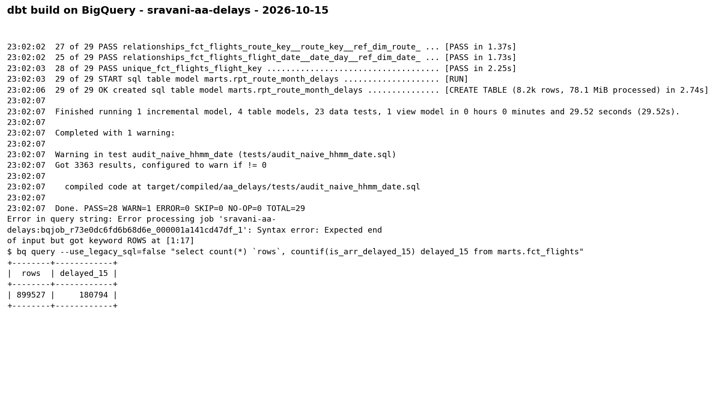

# aa-flight-delays-elt

ELT pipeline over 899,527 American Airlines 2018 domestic flights: Python loader into DuckDB,
dbt star schema with tests and an incremental fact table, orchestrated by an Airflow DAG.

Data: `datasets/aa-domestic-delays-2018.csv.zip` from the code repository of
*Interpretable Machine Learning with Python* (Serg Masís), Chapter 3. Not committed; unzip it into `data/`.

## Finding (2026-10-15)

Building departure time as `flight_date + dep_time (HHMM)` is wrong for **3,363 of 899,527 flights (0.37%)**:

| Case | Flights | What the naive method does |
|---|---:|---|
| Departed after midnight, the day after the scheduled date | 3,202 | dates the flight 24 h early |
| Departed early, before midnight on the previous evening | 128 | dates the flight 24 h late |
| Clock recorded as `2400` | 33 | produces the invalid time 24:00 |

`stg_flights.actual_dep_ts` uses `scheduled departure + dep_delay` instead.
`tests/assert_actual_dep_matches_clock.sql` passes on all 899,527 rows;
`tests/audit_naive_hhmm_date.sql` (severity warn) returns the 3,363 rows above.

Also in this extract: zero null departure or arrival times, so cancelled and diverted flights are
not present. Any on-time rate computed from it describes completed flights only.
20.10% of flights arrived 15+ minutes late (180,794).

## Layout

| Path | What it does |
|---|---|
| `ingest/load_raw.py` | Loads the CSV into `raw.flights`, one month per delete+insert, so a month can be reloaded alone |
| `aa_delays/models/staging/stg_flights.sql` | Types, renames, surrogate keys, midnight-safe `actual_dep_ts` |
| `aa_delays/models/marts/fct_flights.sql` | Fact, one row per flight leg; incremental on `_loaded_at`, upsert on `flight_key` |
| `aa_delays/models/marts/dim_airport.sql`, `dim_route.sql`, `dim_date.sql` | Dimensions (110 airports, 815 routes, 365 days) |
| `aa_delays/models/marts/rpt_route_month_delays.sql` | Reporting dataset for a BI tool, one row per route per month (8,166 rows) |
| `aa_delays/macros/` | `surrogate_key`, `hhmm_to_minutes`, `iso_day_of_week` (adapter-dispatched for DuckDB and BigQuery), `generate_schema_name` |
| `aa_delays/tests/` | Custom generic test `within_range`; singular tests for source-to-target reconciliation, delay-cause totals, clock consistency, and the naive-HHMM audit |
| `airflow/dags/aa_delays_elt.py` | `load_raw >> dbt_run >> dbt_test >> dbt_docs`; conf `{"month": "2018-12"}` reloads one month |
| `run_logs/` | Output of the two Airflow runs below |

## Tests

23 dbt tests: unique / not_null keys, relationships from the fact to every dimension,
range checks, accepted ISO weekday values, plus:

- `assert_fct_reconciles_to_raw`: fact and raw match on row count and total arrival-delay minutes
- `assert_delay_causes_sum_to_arr_delay`: cause minutes add up to `arr_delay` for 15+ minute delays, and are zero otherwise
- `assert_actual_dep_matches_clock`: `actual_dep_ts` lands on the recorded `dep_time`

## Run

Linux, macOS or WSL (Airflow does not run natively on Windows).

```bash
python -m venv .venv-dbt && .venv-dbt/bin/pip install -r requirements-dbt.txt
python -m venv .venv-af  && .venv-af/bin/pip install "apache-airflow==2.10.5" \
  -c https://raw.githubusercontent.com/apache/airflow/constraints-2.10.5/constraints-3.10.txt

export AA_PROJECT_DIR=$PWD AA_PYTHON=$PWD/.venv-dbt/bin/python AA_DBT_BIN=$PWD/.venv-dbt/bin/dbt
export AA_DUCKDB_PATH=$PWD/warehouse/aa.duckdb
export AIRFLOW_HOME=$PWD/airflow_home AIRFLOW__CORE__DAGS_FOLDER=$PWD/airflow/dags AIRFLOW__CORE__LOAD_EXAMPLES=False
mkdir -p warehouse && .venv-af/bin/airflow db migrate

.venv-af/bin/airflow dags test aa_delays_elt 2026-10-15                          # full load
.venv-af/bin/airflow dags test aa_delays_elt 2026-10-16 -c '{"month": "2018-12"}'  # reload December only
```

dbt alone: `cd aa_delays && dbt build --profiles-dir .`

## Results (run 2026-10-15)

| Run | load_raw | dbt run | dbt test | dbt docs |
|---|---|---|---|---|
| Full | 899,527 rows, 12 months | PASS=6 | PASS=22 WARN=1 ERROR=0 | success |
| December reload | 74,551 rows | PASS=6 | PASS=22 WARN=1 ERROR=0 | success |

After the December reload, `fct_flights` holds 899,527 rows, of which 74,551 carry the new `_loaded_at`:
the incremental model picked up only the reloaded month. The single warning is the naive-HHMM audit.

Versions: Python 3.10.12, dbt-core 1.10.23, dbt-duckdb 1.11.0, DuckDB 1.5.6, Apache Airflow 2.10.5.

## BigQuery run (2026-10-15)

Same dbt project, `--target bq`, on a free BigQuery sandbox project (`sravani-aa-delays`, US).
`raw.flights` was loaded with `bq load` (explicit schema, `planned_dep_datetime` as DATETIME) into
`raw.flights_csv`, then a CTAS added `_load_month` and `_loaded_at`: 899,527 rows.

| Step | Result |
|---|---|
| `dbt build --target bq` | 6 models OK, 22 tests PASS, 1 WARN (`audit_naive_hhmm_date`, 3,363 rows), 0 ERROR (dbt line: `PASS=28 WARN=1 ERROR=0 TOTAL=29`) |
| Bytes processed | `fct_flights` 97.8 MiB, `rpt_route_month_delays` 78.1 MiB, `dim_route` 15.4 MiB, `dim_airport` 8.6 MiB, `dim_date` 6.9 MiB |
| `marts.fct_flights` | 899,527 rows, 180,794 arrived 15+ minutes late |

Same numbers as DuckDB. No macro changes were needed: the existing `bigquery__iso_day_of_week`
dispatch and dbt's cross-database `hash`, `concat`, `dateadd` and `date_trunc` covered the differences.
In the log, the first count query fails because `rows` is a reserved word in BigQuery; it was rerun
with the alias quoted.

Versions: dbt-core 1.10.23, dbt-bigquery 1.12.1. Full log: `run_logs/dbt_build_bigquery.log`.


